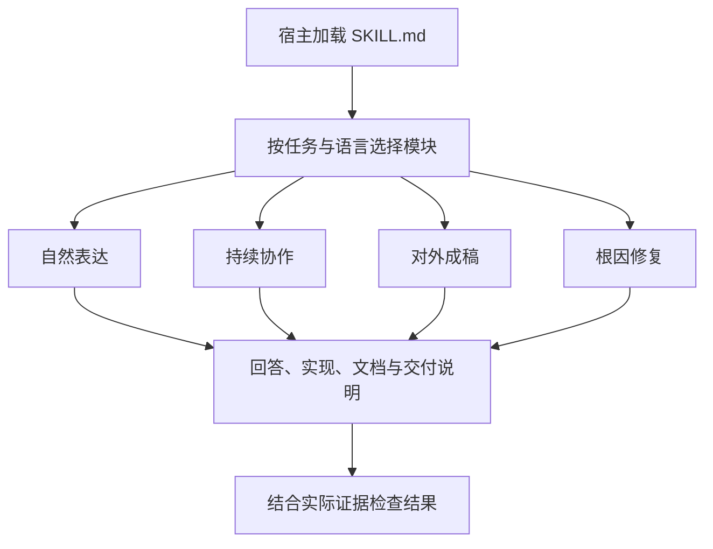

# No Negative Echo

**让 agent 围绕当前目标，完成清楚、一致、可验证的交付。**

No Negative Echo 是一套可跨 agent harness 使用的双语技能，提供自然表达、持续协作、对外成稿和根因修复四组规则。它把用户已确认的需求、当前实现和验收证据作为共同依据，帮助回答、代码、文档与提交说明表达同一套设计。

**版本 2.1.0** · [English](README_EN.md) · [安装](INSTALL.md) · [使用说明](docs/zh-CN/usage.md) · [Agent 阅读入口](llms.txt)

通过标准 `SKILL.md` 入口与按需模块复用同一套规则；提供 Codex、Claude Code、Cursor、Gemini CLI、Copilot CLI 和 OpenCode 的接入路径。完整运行包可本地保存，日常指令只需宿主读取文本。各宿主的接入方法与验证状态见[兼容说明](docs/zh-CN/harnesses.md)。

## 能用它完成什么

| 工作场景 | 技能如何处理 | 对交付的作用 |
|---|---|---|
| 问答与需求纠正 | 先回答当前问题，按读者需要补充解释，将纠正落实到后续结果 | 让读者更快找到答案，保持多轮沟通中的需求一致 |
| 持续执行任务 | 推进已授权工作，汇报实质发现、阻塞和决策变化，验证实际使用路径 | 让进展和完成状态有明确依据，便于判断下一步 |
| README、项目介绍与客户材料 | 围绕成果、实现机制和有依据的收益组织正文，明确适用范围 | 让首次接触项目的读者理解它能做什么、如何发挥作用 |
| 代码修复与提交 | 定位产生错误的抽象、数据流、接口或状态来源，同步实现、配置和文档 | 形成可独立理解和维护的当前设计 |

## 它怎样工作

入口 [SKILL.md](no-negative-echo/SKILL.md) 提供共用规则，再按任务读取相应的中文或英文模块。一次任务可以组合使用多个模块，例如修复功能时应用工程规则，撰写发布介绍时应用成稿规则。



1. **确定当前目标。** 从用户确认的需求、已有授权和实际状态中确定本次要完成的结果。
2. **按场景形成成果。** 回答围绕问题展开，代码在错误来源处修正，文稿按受众需要组织功能、方法和价值。
3. **核对实际交付。** 检查正文、文件名、注释、提交信息及交付说明与当前实现是否一致，用相应证据支持完成声明。

宿主负责模型、工具和权限，技能提供任务规则。附带的文本扫描器可按指定词检查文件内容和名称，供需要精确匹配时使用。

## 使用示例

安装后，Codex 使用 `$no-negative-echo`，Claude Code 使用 `/no-negative-echo`；其他宿主可通过技能选择器或明确指定技能名称调用。以下示例采用 Codex 写法：

**撰写对外介绍**

```text
使用 $no-negative-echo 改写项目 README。
面向首次了解项目的开发者，写清功能、实现方式和实际用途。
```

例如，已确认的功能是“本地目录每日增量备份、按变更块保存、按日期恢复”，可以写成：

> 支持本地目录每日增量备份，按变更块保存数据，减少重复存储；可按日期恢复，方便找回所需版本。

这段介绍将能力、机制和用途连在一起。涉及性能、效率等量化收益时，使用已有测量结果；计划中的收益标为预期。

**完成代码修复**

```text
使用 $no-negative-echo 修复任务状态不同步的问题。
检查状态来源和更新路径，形成统一的状态管理实现，
同步相关文档，并验证启动、停止和状态读取行为。
```

**整理提交与交付说明**

```text
使用 $no-negative-echo，根据最终 diff 和实际测试结果，
撰写 commit、PR 正文与交付说明，写清当前行为和验证结果。
```

成果介绍以功能、方法和收益为主线。迁移指南、风险评审、问题分析等文体按各自目的展开；Commit 和 PR 结合读者需要说明触发条件、兼容影响和验证事实。

## 安装

准备 Git、Python 3.10+ 和目标宿主。以 Codex 为例，在终端运行：

```bash
git clone https://github.com/HNNUYUXUAN/no-negative-echo.git
cd no-negative-echo
python -I -B scripts/install_skill.py --expected-provenance-sha256 7f5afc287bf98e3d52cdb33c934ed9385c800aa96276600b1cfc6a0967bff714 --agent codex
```

安装器校验来源清单和文件内容，将完整技能放入所选目录。其他预设为 `claude`、`cursor`、`gemini` 和 `copilot`，将命令中的 `codex` 替换为对应值即可。已有共享安装时先按[兼容说明](docs/zh-CN/harnesses.md)确认生效位置。安装或更新后按宿主方式重新加载，再完成一个[使用样例](docs/zh-CN/usage.md)。

OpenCode、项目级目录和自定义 harness 使用[接入指南](docs/zh-CN/harnesses.md)。只支持文本上下文的宿主，可从 [llms-full.txt](llms-full.txt) 选择入口和相关模块。日常规则使用无需 Python。

已有上游版本时，按 [来源迁移步骤](INSTALL.md#source-migration-from-lb623) 保存旧版并安装本 fork。自定义目录及安装状态说明也见 [INSTALL.md](INSTALL.md)。

## 给 agent 和维护者

- [llms.txt](llms.txt)：按任务定位规则、使用说明、接入路径与验证资料。
- [llms-full.txt](llms-full.txt)：自动生成的完整阅读副本，包含双语规则、安装和维护说明，可离线保存。
- [维护与接续](docs/zh-CN/maintenance.md)：完整克隆、版本更新、来源迁移、备份与回滚。
- [版本记录](CHANGELOG.md)：每版的改动与迁移事项。

运行包、安装器、源文档和开发检查均保存在本仓库。完整克隆可独立用于本地安装与后续维护；随包 MIT 许可和原作者署名支持继续分享与改造。

## 设计与验证资料

项目提供中英文规则、可复现任务和输出记录，便于检查规则与实际表现的对应关系。已有行为回放来自 Windows x64 上的 Codex CLI；其他宿主的原生行为待接收端验证。各版本检查与覆盖范围见[验证记录](VALIDATION.md)。

| 资料 | 内容 |
|---|---|
| [研究来源](research.md) | 社区反馈和写作实践，说明场景选择的依据 |
| [对照回放任务](evals/fork-prompts.jsonl) | 问答、纠正、进展、成稿、迁移和工程修复场景 |
| [回放结果](evals/replay-results.json) | 上游与本 fork 的输出及校验信息 |
| [评测协议](evals/evaluation-protocol.md) | 行为评测的设计与证据要求 |

运行开发检查：

```bash
python scripts/build_release.py
python -I -m unittest discover -s tests -p 'test_*.py'
```

`python evals/run_fork_replay.py` 可重新执行 40 次 Codex CLI 文本回放，使用当前账号额度，中间记录保存到仓库外的工作目录。

## 项目来源

本 fork 由 [HNNUYUXUAN](https://github.com/HNNUYUXUAN) 维护，基于 [LB623/no-negative-echo](https://github.com/LB623/no-negative-echo) 的提交 `eba9f1d2`，保留原作者署名，采用 [MIT License](LICENSE)。
