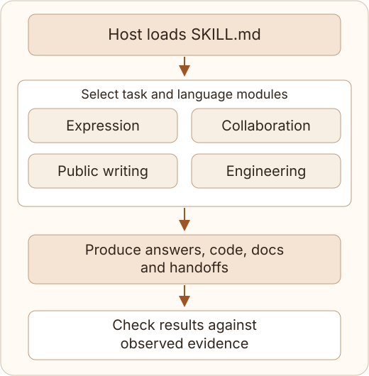

# No Negative Echo

**Help agents turn the current goal into clear, consistent, verifiable deliverables.**

No Negative Echo is a portable bilingual skill for agent harnesses, with four sets of rules: natural expression, ongoing collaboration, public-facing writing and root-cause repairs. It uses accepted requirements, the current implementation and verification evidence as a shared basis for answers, code, documentation and commit descriptions.

**Version 2.1.0** · [中文](README.md) · [Installation](INSTALL.md) · [Usage](docs/en/usage.md) · [Agent reading index](llms.txt)

A standard `SKILL.md` entry and on-demand modules make the same rules reusable across hosts. Integration paths cover Codex, Claude Code, Cursor, Gemini CLI, Copilot CLI and OpenCode. Keep the complete runtime locally; daily use needs only a host that reads text. See the [integration guide](docs/en/harnesses.md) for host-specific methods and validation status.

## What you can use it for

| Situation | How the skill approaches it | Value to the reader or collaborator |
|---|---|---|
| Questions and requirement corrections | Answer the current question, explain what the reader needs and carry corrections into subsequent results | Make answers easier to find and keep requirements consistent across turns |
| Ongoing tasks | Continue authorized work, report substantive findings and decisions, and verify the actual usage path | Give progress and completion claims a clear basis for deciding what comes next |
| READMEs, project introductions and customer materials | Connect capabilities, mechanisms and supported benefits, with clear applicability | Help new readers understand what the project does and how it helps them |
| Code repairs and commits | Locate the abstraction, data flow, interface or state source causing a defect, then align implementation, configuration and documentation | Produce a current design that can be understood and maintained on its own |

## How it works

The [SKILL.md](no-negative-echo/SKILL.md) entry point provides shared rules and routes each task to the relevant Chinese or English module. A task can combine modules: engineering rules guide a repair, while writing rules guide its public introduction.



1. **Establish the current goal.** Use accepted requirements, existing authorization and the observed state to determine the result to deliver.
2. **Produce the result for its context.** Answer the question, repair code at the source of the defect, and organize writing around the audience's needs, capabilities and value.
3. **Check the actual deliverables.** Review prose, filenames, comments, commit text and handoffs for consistency with the implementation, supporting completion claims with appropriate evidence.

The host supplies the model, tools and permissions; the skill supplies task rules. An included text scanner checks file contents and names against specified terms when exact matching is useful.

## Usage examples

After installation, use `$no-negative-echo` in Codex or `/no-negative-echo` in Claude Code. Other hosts can use their skill selector or an explicit request naming the skill. The examples below use Codex syntax.

**Write a public introduction**

```text
Use $no-negative-echo to rewrite this project's README.
Write for developers discovering the project: explain its capabilities,
how they work and their practical uses.
```

For a confirmed feature that backs up local directories daily, stores changed blocks and restores by date, an introduction could read:

> Daily incremental backups store changed blocks from local directories, reducing duplicate storage. Restore by date to recover the version you need.

The introduction connects capabilities, mechanisms and uses. Quantified performance or efficiency benefits use existing measurements; planned benefits are labeled as expected.

**Complete a code repair**

```text
Use $no-negative-echo to fix inconsistent task state.
Inspect the state source and update paths, implement unified state management,
update relevant documentation, and verify start, stop and state-reading behavior.
```

**Prepare commits and handoffs**

```text
Use $no-negative-echo to write a commit, PR body and handoff from the final diff
and actual test results. Describe the current behavior and verification.
```

Value introductions focus on capabilities, methods and benefits. Migration guides, risk reviews and problem analyses follow their respective purposes. Commits and PRs include triggering conditions, compatibility effects and verification facts when readers need them.

## Installation

With Git, Python 3.10+ and a target host available, run this Codex example:

```bash
git clone https://github.com/HNNUYUXUAN/no-negative-echo.git
cd no-negative-echo
python -I -B scripts/install_skill.py --expected-provenance-sha256 7f5afc287bf98e3d52cdb33c934ed9385c800aa96276600b1cfc6a0967bff714 --agent codex
```

The installer verifies provenance and file contents, then places the complete package in the selected directory. Other presets are `claude`, `cursor`, `gemini` and `copilot`: replace `codex` in the command accordingly. For existing shared installations, first confirm the effective location using the [integration guide](docs/en/harnesses.md). Reload through the host after installation or upgrade, then complete a [usage example](docs/en/usage.md).

For OpenCode, project-local paths and custom harnesses, follow the [integration guide](docs/en/harnesses.md). Text-only hosts can select the entry and relevant modules from [llms-full.txt](llms-full.txt). Daily instruction use requires no Python runtime.

For an existing upstream installation, follow the [source migration steps](INSTALL.md#source-migration-from-lb623) to preserve it and install this fork. [INSTALL.md](INSTALL.md) also covers custom directories and installation status.

## For agents and maintainers

- [llms.txt](llms.txt): Task-oriented index of rules, usage, integration and evidence.
- [llms-full.txt](llms-full.txt): Generated full reading copy containing bilingual rules, installation and maintenance instructions for offline use.
- [Maintenance and continuity](docs/en/maintenance.md): Complete clones, releases, source migration, backups and rollback.
- [Changelog](CHANGELOG.md): Version scope and migration notes.

The runtime, installer, source documentation and development checks live in this repository. A full clone supports local installation and continued maintenance independently. The bundled MIT license and original attribution support further sharing and adaptation.

## Design and validation resources

The project includes bilingual rules, reproducible tasks and recorded outputs for inspecting how the rules relate to observed behavior. Existing behavioral replays use Codex CLI on Windows x64; native behavior on other hosts awaits recipient validation. See [the validation record](VALIDATION.md) for checks and coverage by release.

| Resource | Contents |
|---|---|
| [Research sources](research.md) | Community feedback and writing practices informing the scenarios |
| [Replay tasks](evals/fork-prompts.jsonl) | Questions, corrections, progress, public copy, migration and engineering repairs |
| [Replay results](evals/replay-results.json) | Outputs and integrity information for upstream and fork conditions |
| [Evaluation protocol](evals/evaluation-protocol.md) | Behavioral evaluation design and evidence requirements |

Run development checks:

```bash
python scripts/build_release.py
python -I -m unittest discover -s tests -p 'test_*.py'
```

`python evals/run_fork_replay.py` runs 40 Codex CLI text replays using the current account quota. Intermediate records are stored in a working directory outside the repository.

## Project origins

Maintained by [HNNUYUXUAN](https://github.com/HNNUYUXUAN), this fork is based on [LB623/no-negative-echo](https://github.com/LB623/no-negative-echo), commit `eba9f1d2`, with original attribution retained under the [MIT License](LICENSE).
